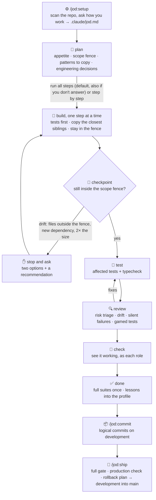

<div align="center">

# jod

### जोड — put the parts together so they hold

An engineering workflow plugin for [Claude Code](https://claude.com/claude-code). **It plans, builds, tests, reviews, verifies and ships the way a small team of senior engineers would: in scope, in your codebase's own style, with evidence that it works. It adapts to new, growing or established projects.**

[](LICENSE)


</div>

---

## Install

### Claude Code

Run inside Claude Code:

```
/plugin marketplace add l3lackcurtains/jod
/plugin install jod@jod
```

### Codex, Cursor, OpenCode, GitHub Copilot, Gemini CLI, ZCode

These tools get jod as portable [Agent Skills](https://agentskills.io).

**macOS / Linux / Git Bash:**

```bash
curl -fsSL https://raw.githubusercontent.com/l3lackcurtains/jod/main/install.sh | bash -s -- all
```

**Windows PowerShell:**

```powershell
& ([scriptblock]::Create((irm https://raw.githubusercontent.com/l3lackcurtains/jod/main/install.ps1))) -Targets all
```

To install for a single tool or into one project only, see [Other AI tools](#other-ai-tools).

## Commands at a glance

```
/jod:setup        → scan the stack + patterns, ask how you work, write the profile
/jod:task <task>  → plan → build → test → review → check → done, with a drift alarm
/jod:fix <bug>    → reproduce → root cause → failing test → fix → hunt the same bug
/jod:commit       → calibrated review → verify → commit in logical groups → push
/jod:ship         → cross-commit review → full gate → production check → development into main
```

---

## Why

AI coding agents are fast, but in a real codebase they drift:
- they add things nobody asked for;
- they invent a second way of doing something the repo already does;
- they pull in dependencies;
- they "tidy" code mid-feature;
- they weaken tests until they pass;
- they say "done" without proof.

Big-team process (sign-offs, templates, design docs) is too slow to fix that for a team of one to three people.

jod puts the habits of small, high-output teams into the agent instead:

- **Stay on the road.**
  - Each plan has a *scope fence*.
  - A drift alarm checks after every build step.
  - At any surprise, Claude stops and asks with two options and a recommendation instead of improvising.
- **Change it everywhere.** Each plan maps the change's impact across every app, package, SDK, CLI, doc, test and piece of stored data. Before "done", the searches run again, and any place the change missed fails the check.
- **Look like the codebase.** Before writing a file, study its 2–3 closest siblings, reuse before you create, and extract only when something would be duplicated.
- **Build it right, in proportion.** Simplicity first, then boundaries, scalability, reliability and security, each applied where it matters. A payment flow gets idempotency; an admin toggle doesn't.
- **Evidence, not vibes.** "Done" means a command run in this turn, with its exit code and counts. Review is calibrated: risk triage, findings it would bet on, and checks for silent failures and gamed tests.
- **Learn.** Corrections become one-line additions to the project profile. A rule broken twice becomes a hook.

## How it works



- **One profile per repo.** `/jod:setup` scans your stack, conventions, CI, branches, environment and existing patterns, shows you what it found, and asks how you want to work. It then writes `.claude/jod.md`. Everything project-specific lives there; the plugin itself stays generic.
- **Three modes**, chosen during setup:

| Mode | For | Existing patterns | New pattern or dependency |
|---|---|---|---|
| `established` | settled codebases | followed strictly | your decision: Claude stops and asks |
| `growing` | active products | followed; improvements as their own planned step | allowed when the plan justifies it, then recorded |
| `new` | early projects | few exist yet | the stack's standard, boring choice; recorded as a convention |

## Commands

| Command | What it does |
|---|---|
| `/jod:setup [refresh]` | Scan the repo, ask how you work, write or update the profile, offer hard guards (deny rules and hooks) |
| `/jod:task <task>` | The full loop: plan (split into as many steps as the work needs) → you choose "run all steps" or "step by step" (no answer means run all) → each step goes build → test → review → check → done |
| `/jod:task plan\|build\|test\|review\|check\|done …` | Run one phase on its own; `build <slug>` resumes a saved plan in a fresh session |
| `/jod:fix <symptom>` | Reproduce, trace the root cause backward, write a regression test that fails first, fix, hunt the same bug across the repo, verify |
| `/jod:commit` | Step 1: review the uncommitted diff, verify, commit in logical groups to `development` (merging any side branch into it), push. Never touches `main` |
| `/jod:ship` | Step 2, and the only way into `main`: review across commits, the full gate, a production check (runs the release as production does: direct, Compose, Kubernetes…), a deploy audit with a rollback plan, then merge `development` into `main` |

The **`engineering`** skill loads automatically whenever Claude builds or reviews code. It holds the standards:

| Guide | Covers |
|---|---|
| [principles.md](skills/engineering/principles.md) | simplicity, boundaries, scalability, reliability, security, operability; each section ends with the questions review asks |
| [patterns.md](skills/engineering/patterns.md) | finding the closest examples, reusing before creating, when to extract, legacy patterns |
| [review.md](skills/engineering/review.md) | risk triage, calibrated findings, drift, silent failures, gamed tests, plan gaps |
| [verify.md](skills/engineering/verify.md) | the checks per change, the full gate, what counts as proof |
| [impact.md](skills/engineering/impact.md) | find everything a change touches (every app, client, doc, test, stored data, clients in the wild), then prove each place was covered |
| [report.md](skills/engineering/report.md) | how each command reports, in the shape that fits its job: an incident note for a fix, release notes and a runbook for a ship, a commit log for a commit |

## A task, end to end

```
> /jod:task add CSV export to the invoices list

plan    Appetite: half a day. Scope fence: invoices.controller, invoices.service,
        invoices-table.tsx, use-invoices.ts. Not doing: PDF export.
        Patterns: modelled on the orders export (orders.service.ts#exportCsv).
        Engineering: stream rows, cap at 50k, tenant-scoped query, permission invoices.export.
        Build it?
> yes
build   Wrote 4 failing tests → implemented → checkpoint: 4 files, all inside the fence.
test    api: tsc ok, 312 passed · web: 88 passed
review  1 HIGH file (permission). Fixed: export ignored the tenant filter on archived invoices
        (+ regression test). Skipped: "add retry" (no caller needs it).
check   Exported as admin and as viewer (viewer gets 403). File opens in Excel.
done    Profile: + "CSV exports stream through lib/csv.ts". Suggest /jod:commit.
```

## The profile

`.claude/jod.md` is short. Every line is something Claude couldn't have guessed:

- **How we work:** the mode, when plans need your approval, and when tests get written
- **Conventions:** the current way of doing each thing, plus what's legacy and must not be copied
- **Stack, and the layers or surfaces** to change, in build order
- **Verify commands,** and the full gate
- **Branches and release:** the branch names, whether pushing `main` deploys, what never gets staged
- **Production:** the runtime (direct, Compose, Kubernetes, serverless), the start command, the health check, smoke requests, migrations
- **Local environment:** dev servers, a shared or production database, how the agent can check its own work
- **High-risk areas,** reviewed line by line
- **Reference implementations** to copy, **hands-off code**, and **gotchas**

See the examples: [an established monorepo](examples/established-monorepo.md) and [a new API](examples/new-api.md). Commit your profile; it's documentation your teammates' agents can use too.

## Other AI tools

jod is written in the open [Agent Skills](https://agentskills.io) format. `portable/` holds the same skills for tools other than Claude Code:
- skills are named `jod-task`, `jod-fix`, `jod-commit`, `jod-ship`, `jod-setup` and `jod-engineering`;
- Claude-only syntax is rewritten.

It's generated from `skills/` by `scripts/build-portable.mjs`.

| Target | Installs to | Read by |
|---|---|---|
| `agents` (default) | `~/.agents/skills` | Codex, Cursor, OpenCode, GitHub Copilot, Gemini CLI |
| `zcode` | `~/.zcode/skills` | ZCode |
| `claude` | `~/.claude/skills` | Claude Code without the plugin; also OpenCode and Cursor |
| `cursor` · `opencode` · `copilot` · `gemini` | each tool's own folder | that tool only |
| `all` | `agents` + `zcode` | |

```bash
bash install.sh agents zcode        # from a clone; or pipe it from curl as above
bash install.sh agents --project    # into the current repo (.agents/skills) instead of your home folder
```

Then invoke the skills the way your tool does: `/jod-setup` or `/jod-task …`, or ask "use the jod-task skill to …". The project profile stays at `.claude/jod.md` in every tool.

Install for one family of tools only, because tools that read several folders would see jod twice. Claude Code users should stick to the plugin.

## Branches

One flow, on purpose:

```
side branch ──merge──▶ development ──/jod:ship──▶ main ──▶ production
                 (/jod:commit)       (the only way in)
```

- All work lands on `development`. A side branch (a spike, a worktree) gets merged into `development` by `/jod:commit`.
- Nothing is ever committed directly to `main`, and there are no PRs. `/jod:ship` is the only thing that merges `development` into `main`.
- Before merging, `/jod:ship` proves the release runs **the way production runs it**, whether that's a direct process, Docker Compose, Kubernetes or serverless. It builds from a clean checkout with production-like config, starts the app, smoke-tests it and shuts it down. If any of that can't be verified, it blocks.

## Design choices

- **For one to three engineers.** Sign-offs, reviewer assignment, PR templates, RFCs for small changes and coverage targets are left out on purpose.
- **Cheap by default.** Each step runs only the affected tests; the full suites run once. The independent review agent runs only on high-risk or large diffs. Guides load only when a phase needs them.
- **Restart instead of grinding.** After two failed rounds, Claude writes a handoff into the plan file and recommends a fresh session.
- **Profile beats plugin.** When they disagree, your profile wins.

## Contributing

Issues and PRs are welcome, especially:
- profiles for other stacks;
- places where a guide was confusing or let Claude drift;
- trimming text that doesn't earn its place.

See [CONTRIBUTING.md](CONTRIBUTING.md).

## Sources

jod stands on:
- Anthropic's [skill authoring](https://platform.claude.com/docs/en/agents-and-tools/agent-skills/best-practices) and [Claude Code](https://code.claude.com/docs/en/best-practices) best practices
- [obra/superpowers](https://github.com/obra/superpowers): verification before completion, root-cause tracing, test-driven development, plans without placeholders
- [Trail of Bits skills](https://github.com/trailofbits/skills): differential review, variant analysis, insecure defaults
- Google's [engineering practices](https://google.github.io/eng-practices/)
- Michael Feathers, *Working Effectively with Legacy Code*; Kent Beck, [*Tidy First?*](https://tidyfirst.substack.com/) and [augmented coding](https://newsletter.kentbeck.com/p/augmented-coding-beyond-the-vibes)
- 37signals [Shape Up](https://basecamp.com/shapeup); Dan McKinley, [Choose Boring Technology](https://mcfunley.com/choose-boring-technology)
- Mitchell Hashimoto, Armin Ronacher, Harper Reed and Geoffrey Huntley on agentic coding

## License

[MIT](LICENSE)
